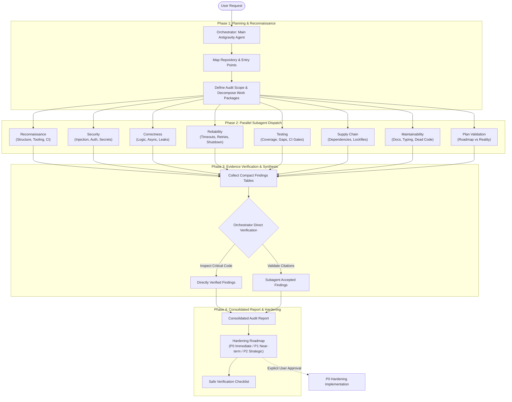

# python-project-audit

[](https://antigravity.google)
[](LICENSE)

A multi-agent codebase auditor, plan validator, and hardening orchestrator for Python repositories, built for **Google Antigravity**.

It enforces an explicit **orchestration contract**: the primary agent acts as orchestrator—planning the audit, dispatching bounded subagents in parallel, directly verifying evidence, and authoring the final hardening plan.

---

## Architecture & Orchestration Model



### Key Orchestration Rules
- **Main Agent (Orchestrator):** Owns scope definition, brief creation, subagent invocation (`invoke_subagent`), evidence cross-checking, and final report delivery.
- **Subagents (Workers):** Read-only workers that return compact findings tables (under 150 words summary + structured markdown tables). They never modify code, install packages, or author the final report.
- **Zero Surprises:** Non-destructive and read-only by default. Code changes require explicit user approval.

For a detailed breakdown of the contract, see [docs/ORCHESTRATION.md](docs/ORCHESTRATION.md).

---

## Subagent Work Packages

| Work Package | Focus Area | Deliverable to Orchestrator |
|---|---|---|
| **Repository Reconnaissance** | Structure, entry points, tooling, packaging, CI | Compact architecture map and key file inventory |
| **Security Review** | Injections, auth, secrets, unsafe APIs, container configs | Findings table with severity, impact, and fix |
| **Correctness Review** | Logic bugs, async misuse, concurrency races, leaks | Findings table with reproducible failure conditions |
| **Reliability Review** | Timeouts, retries, graceful shutdown, logging, metrics | Operational risk matrix and hardening advice |
| **Testing Review** | Critical failure paths, mock quality, CI gate reality | Test coverage gap analysis and prioritised test plan |
| **Dependency & Supply Chain** | Version pinning, lockfiles, known vulnerabilities | Dependency hygiene report |
| **Documentation & Maintainability**| README vs reality, API typing, dead code | Documentation gap list and maintainability score |
| **Plan Validation** | Stated roadmap vs actual code implementation | Alignment matrix, unverified assumptions, design risks |

---

## Installation

### Option 1: Global Antigravity Plugin (Recommended)
Install directly using the Antigravity CLI:
```bash
agy plugin install https://github.com/otter-twunk/python-project-audit
```

### Option 2: Project-Scoped Skill
Add the skill to any specific repository under `.agents/skills/`:
```bash
mkdir -p .agents/skills/python-project-audit
cp -r skills/python-project-audit/* .agents/skills/python-project-audit/
```

### Option 3: Global User Skill
Link or copy into your machine's global skills directory:
```bash
ln -s "$(pwd)/skills/python-project-audit" ~/.gemini/config/skills/python-project-audit
```

---

## How to Use

### 1. Read-Only Comprehensive Audit
Ask Antigravity in your chat or terminal:

```text
Use the python-project-audit skill to perform a full audit of this repository.
Do not modify any files. Focus first on correctness, security, reliability, and whether
the current implementation plan is sound. Produce the full findings register and a
prioritised hardening plan.
```

### 2. Implementation Pass (Hardening P0 Fixes)
After reviewing the findings, execute immediate fixes:

```text
Use the python-project-audit skill. Review the audit findings and implement only the
P0 hardening items. Before changing anything, present the exact files you intend to
modify, the proposed changes, and the tests you will add or update. Then implement,
run the relevant checks, and report results.
```

---

## Repository Structure

```text
.
├── LICENSE
├── README.md                                           # Project overview & diagrams
├── plugin.json                                         # Antigravity plugin manifest
├── assets/
│   └── logo.svg                                        # High-contrast plugin icon
├── docs/
│   └── ORCHESTRATION.md                                # Deep dive into multi-agent contract
└── skills/
    └── python-project-audit/
        ├── SKILL.md                                    # Master skill definition
        ├── scripts/
        │   └── audit_checks.sh                         # Safe diagnostic execution script
        └── references/
            ├── subagent_brief_templates.md             # Brief templates for each work package
            └── audit_report_template.md                # Authoritative report schema
```

---

## License

[MIT](LICENSE) © 2026 otter-twunk
