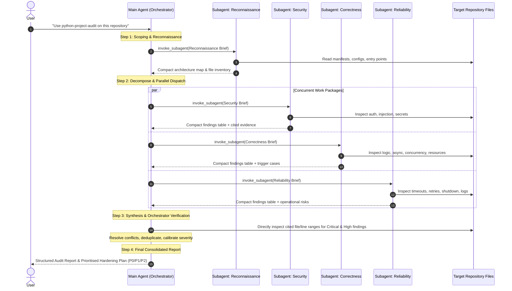
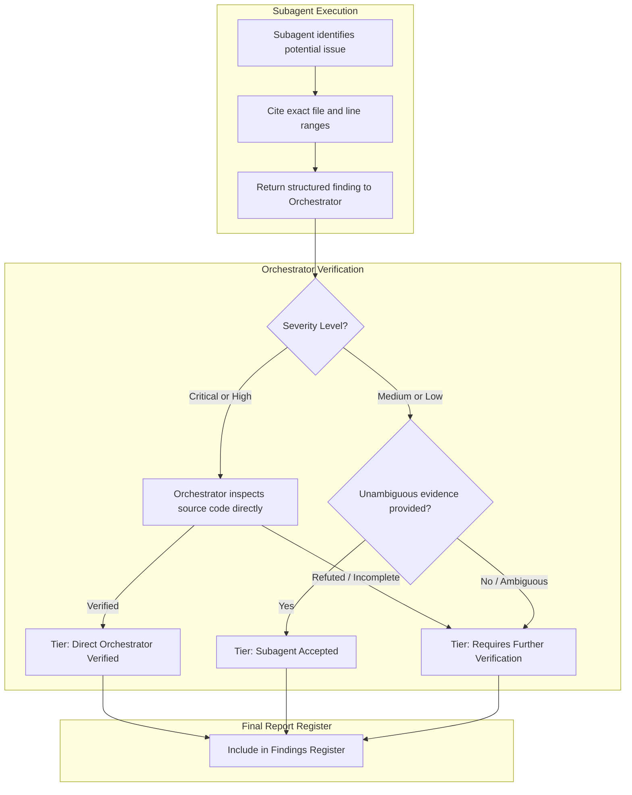

# Orchestration Contract & Multi-Agent Architecture

## 1. Why Multi-Agent Orchestration Matters

When an autonomous AI coding assistant audits an entire repository, single-agent architectures suffer from **context window saturation**:
1. **Context Pollution:** Reading tens of source files, dependency manifests, and CI logs fills the prompt buffer, pushing earlier analysis out of the attention window.
2. **Superficial Coverage:** To conserve context, single agents begin skimming, skipping files, or guessing behavior.
3. **Hallucination Risk:** Without isolation, the agent blends context from different packages or issues speculative findings without verified file evidence.

The `python-project-audit` skill solves this by establishing a strict **Orchestrator–Worker Contract** powered by Antigravity's `invoke_subagent` capability.

---

## 2. Orchestration Sequence Diagram

---

## 3. Orchestration Contract Principles

### Orchestrator (Main Agent)
- **Role:** Architect, coordinator, verifier, and report author.
- **Responsibilities:**
  - Define audit scope and build high-level architecture map.
  - Decompose review into bounded, independent work packages.
  - Formulate structured subagent briefs with exact boundaries and Definition of Done.
  - Dispatch concurrent subagents.
  - **Verify before accepting:** Personally inspect code for high-severity or ambiguous claims.
  - Author the final consolidated report and hardening roadmap.
  - Never modify files or dependencies without explicit user consent.

### Subagents (Workers)
- **Role:** Specialized, read-only analytical reviewers.
- **Responsibilities:**
  - Execute only the bounded objective in their brief.
  - Return compact, structured findings tables (under 150 words executive summary).
  - Provide concrete file and line citations for every finding.
- **Strict Guardrails:**
  - ❌ MUST NOT modify code or configuration files.
  - ❌ MUST NOT install packages or alter virtual environments.
  - ❌ MUST NOT make external network requests or active security probes.
  - ❌ MUST NOT generate the final user report.

---

## 4. Evidence Verification Tiers

Every finding in the audit report is labeled with its verification tier:
1. **Direct Orchestrator Verified:** Directly checked against repository code by the orchestrator.
2. **Subagent Accepted:** Reported by a subagent with clear, reproducible code evidence.
3. **Requires Further Verification:** Reported concern requiring runtime tests or developer confirmation.
